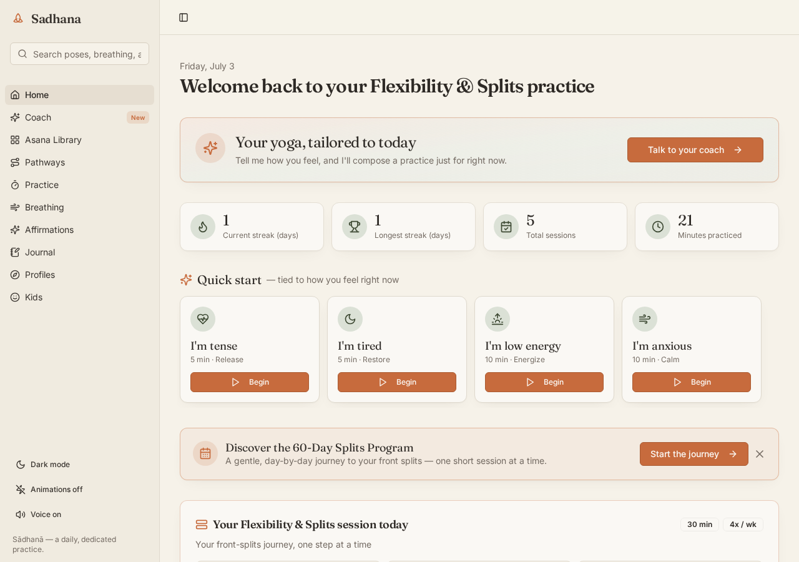

# Sadhana — a calm, guided yoga practice

A free, open-source yoga practice app with illustrated poses, guided voice
sessions, pathway programs, a kids section with story-based poses, and a
custom sequence builder.

**Live app:** https://sadhana-ou9m.onrender.com

[](https://render.com/deploy?repo=https://github.com/Tejaswinireddys/sadhana)




---

## What's inside

- **207 illustrated poses**, each with:
  - a warm illustrated instructor (consistent character across every pose)
  - calm female voice narration (pre-generated, no runtime AI cost)
  - Beginner / Intermediate / Advanced variations with props and cues
  - a "You'll feel this in…" stretch-zone callout
  - contraindications grouped as _avoid / modify / caution_
  - personal notes you can save per pose

- **Yoga Trainer**: answer four quick questions about body, energy, time, and
  need — get a personalized sequence that opens straight into a guided session

- **6 quick flows** for common needs: Morning Wake-Up, Desk Break, Neck &
  Shoulders, Post-Run, Sleep Wind-Down, Core Strong

- **7 sequenced flows**: Sun Salutation A, Sun Salutation B, Moon Salutation,
  Goddess Rising, Hormone Harmony, Moon Cycle Ease, Sacred Feminine Strength

- **4 seven-day challenges**: Hip Opening, Morning Ritual, Sleep Wind-Down,
  Backbend Journey — each with a day-grid tracker

- **Multi-week programs**: a 60-day daily plan toward full front splits with
  mobility check-ins and a journey grid, plus weekly Wheel Backbend and
  Full Forward Fold programs

- **Guided sessions**: a full-screen player that runs any flow with
  synchronized voice, illustrated pose, countdown timer, step captions,
  and automatic pose-to-pose transitions

- **Kids section**: 40 story-based poses ("The Friendly Snake", "The Tall Oak
  Tree", "The Pink Flamingo"…), 4 breathing games (Balloon, Bunny, Bumblebee, Pinwheel), and a
  sticker collection. Parent-gated with a simple math question. Plus **For Men**, **For Women**, and **Pregnancy** practice profiles.

- **Six breathing techniques** with animated visualizers: Box, 4-7-8, Ujjayi,
  Nadi Shodhana, Bhramari, Kapalabhati

- **Optional accounts**: practise as a guest (everything stays on the device)
  or create a free account to sync streaks, journal, and saved sequences across
  browsers — guest practice moves into the account when you sign up

- **Practice tracking**: streaks, longest streak, total minutes, a 12-week
  heatmap, milestone celebrations (7, 30, 100 days…), mood check-ins before
  and after every session

- **Journal**: mood-tagged entries with search & filter, auto-created from
  every completed session

- **65 affirmations** organized around calm, strength, motherhood, clarity,
  self-love, and sleep

- **Custom sequence builder** — create and save your own flows from the
  full pose library and run them in guided mode

- **Global search** across every pose, breathing technique, pathway, and
  affirmation, with English + Sanskrit + forgiving fuzzy match

## Stack

- **Frontend** — React + Vite, Tailwind, shadcn/ui, wouter, TanStack Query
- **Backend** — Node + Express, Drizzle ORM, Postgres
- **Assets** — hand-composed pose illustrations and pre-generated voice
  narrations shipped as static files
- **Deployed on** — [Render](https://render.com) (web service, **Starter / always-on**) +
  [Supabase](https://supabase.com) (Postgres). The web service must not use Render's
  free tier: free instances sleep and first visitors see hosting logs instead of the app.

## Run locally

```bash
git clone https://github.com/Tejaswinireddys/sadhana.git
cd sadhana
npm install
cp .env.example .env
# optional: set DATABASE_URL for Postgres. If unset, an in-memory store is used.
npm run dev
```

Then open http://localhost:5000

Practice data is scoped per browser via an anonymous device id (`X-Device-Id`).
Signing in switches that scope to the account, and the practice already on the
device is carried over. Refreshing mid-session restores your queued poses and
progress.

First-run onboarding, Settings (export/import, reminders, wipe), and an offline
banner are included. Pathway week progress advances only when sessions are logged.

## Deploy your own copy

The app is set up for one-click deploy on Render.

1. Fork this repo.
2. Create a free Postgres database (Supabase or Neon both work). Copy its
   connection string.
3. On [Render](https://render.com), click **New → Blueprint** and point it at
   your fork. Render will read `render.yaml` and provision the web service.
4. When prompted, set the `DATABASE_URL` environment variable to your
   Postgres connection string.
5. First boot creates all tables automatically.

The Blueprint in `render.yaml` requests Render **Starter** so the instance stays
warm. Confirm that plan in the Render dashboard after deploy — a free instance
will still sleep, and the first visit shows Render's "Application loading" screen
for ~30–50 seconds instead of Home. **Before sharing the product publicly, the
web service must be paid / always-on.** Attach a custom domain via `PUBLIC_APP_URL`
(the default `*.onrender.com` URL is fine for demos only). With `PUBLIC_APP_URL`
set, OG tags, canonical URLs, and `/robots.txt` rewrite automatically at serve time.

For error monitoring set `SENTRY_DSN` (server) and `VITE_SENTRY_DSN` (browser).
Regenerate pose WebP siblings with `npm run gen:pose-webp` after adding PNGs.

### Privacy / account controls

- Signed-in users can **delete their account** (password confirm) from Account —
  this clears `user:<id>` practice data and the auth row.
- Guests and accounts can **export a JSON backup** and **wipe device data** from
  Settings / Account (`GET /api/account/export`, `DELETE /api/account/data`).

### Security notes (guest identity)

Guest practice is keyed by a server-signed device cookie. A bare UUID in
`X-Device-Id` is not enough to read another browser’s journal — see
`server/owner.ts`. Auth and write APIs are rate-limited (`server/security.ts`).

## Content credits

- Pose illustrations and voice narrations were composed for this project.
- Yoga instruction is drawn from traditional Hatha, Ashtanga, and modern
  therapeutic lineages. See individual pose descriptions for details.
- All content in this repository is licensed under MIT (see below); please
  practice with awareness of your own body and consult a certified teacher
  or medical professional for anything beyond a personal home practice.

## Design system & product video

- Preview UI tokens and states at `/#/design-system` (also linked from Settings).
- Product overview demo video: [`docs/product-videos.md`](docs/product-videos.md) (wired on the landing page).
- Landing hero 3D approach: [`docs/hero-3d.md`](docs/hero-3d.md).
- Logic surfaces that must stay stable: [`docs/architecture-invariants.md`](docs/architecture-invariants.md).

## Contributing

Issues and pull requests are welcome. If you'd like to add a pose, a new
flow, or a new pathway, follow the pattern in `client/src/data/content.ts`.

## License

MIT — see `LICENSE`.


## Stripe Plus subscriptions (test mode only)

Plus Checkout requires a signed-in account. Guests and new accounts remain
`free`; a verified webhook sets `users.plan` to `plus`. This integration rejects
live secret keys, live prices, and live webhook events. No live payments are
supported.

1. In Stripe **test mode**, create a Plus product with two active, fixed USD
   recurring prices: one every month and one every year. Copy their `price_…`
   IDs. The Plus page reads the amounts from Stripe; the consent snapshot must
   match those amounts before Checkout can begin.
2. Configure the following server environment variables (never put secrets in
   `VITE_*` variables or commit them):

   ```dotenv
   BILLING_ENABLED=true
   STRIPE_SECRET_KEY=sk_test_...
   STRIPE_PRICE_MONTHLY=price_...
   STRIPE_PRICE_YEARLY=price_...
   STRIPE_WEBHOOK_SECRET=whsec_...
   PUBLIC_APP_URL=http://localhost:5055
   PORT=5055
   ```

   Existing `STRIPE_PRICE_PLUS_MONTHLY` / `STRIPE_PRICE_PLUS_YEARLY` names are
   supported as fallback aliases. Use Postgres (`DATABASE_URL`) for durable
   accounts, plans, and Stripe customer/subscription associations. Without it,
   local memory storage resets when the server restarts. Existing consent and
   paywall audit files under `.data/` also need persistent storage if retained.
3. In Stripe's **test Customer Portal settings**, save a configuration that
   enables subscription management and cancellation at the end of the billing
   period. Keep the product catalog limited to the configured Plus prices if
   allowing plan changes. The in-app two-tap cancellation route also remains
   available. See [Stripe's portal setup](https://docs.stripe.com/customer-management/integrate-customer-portal).
4. Forward signed snapshot events locally with the Stripe CLI:

   ```bash
   stripe login
   stripe listen --events checkout.session.completed,customer.subscription.updated,customer.subscription.deleted,invoice.paid,invoice.payment_failed --forward-to localhost:5055/api/billing/webhook
   ```

   Set `STRIPE_WEBHOOK_SECRET` to the `whsec_…` printed by that listener, then
   restart `npm run dev`. For a hosted test deployment, register the HTTPS
   `/api/billing/webhook` endpoint in Stripe test mode and use that endpoint's
   signing secret. See [Stripe's webhook setup](https://docs.stripe.com/webhooks).
5. Sign in, visit `/plus`, select Monthly or Yearly, and click **Subscribe**.
   Use the test card `4242 4242 4242 4242` with a future expiry and any CVC.
   After returning, the page polls the authenticated account for webhook
   confirmation. A success URL alone does not grant access. Use **Manage /
   cancel subscription** to open the portal; it derives the customer ID from
   the signed-in account, not the request body.
6. Verify `/api/auth/me` reports `plan: "plus"`. Schedule cancellation through
   the portal: access remains Plus while the subscription is active/trialing.
   After final cancellation/deletion it returns to free. Inactive, past-due,
   unpaid, or unrecognised-price subscriptions do not grant Plus. Webhook
   reconciliation reads current Stripe state, so repeated or delayed events
   cannot re-enable a canceled subscription or revoke a newer active one.
   Use a real test Checkout/Portal lifecycle to exercise the account mapping;
   standalone `stripe trigger` fixtures usually lack app account metadata.

Endpoints:

- `GET /api/billing/config`: test availability and configured price amounts.
- `POST /api/billing/consent`: existing consent/paywall snapshot capture.
- `POST /api/billing/checkout`: authenticated `{ "plan": "plus", "interval": "month" | "year" }`;
  returns `{ "url": "…" }` after matching consent and price validation.
- `POST /api/billing/portal`: authenticated; returns the account's portal URL.
- `POST /api/billing/webhook`: verifies `Stripe-Signature` against the original
  raw body and handles the subscription lifecycle. Failed processing returns
  a non-2xx response for Stripe to retry.

Automated coverage uses a mocked Stripe API plus real SDK webhook signatures;
no Stripe credentials or network payments are needed for `npm test`. A real
Stripe-account end-to-end test requires your own test keys, price IDs and CLI
listener. All existing catalog content remains free until explicitly marked
`isPlus`; subscribing changes the account plan, not the catalog flags.


## Mux video uploads and playback

Create a Mux API access token with Video read/write permissions and put
`MUX_TOKEN_ID` and `MUX_TOKEN_SECRET` in your local `.env` or server environment.
These credentials are used only by the admin script; they are never bundled
into the browser. The existing `hls.js` dependency supplies browser HLS playback
(native HLS is used on Safari). No Mux SDK install is needed.

Run from the repository root with a real catalog slug:

```bash
npm run upload:mux -- --kind pose --slug tadasana --file /path/to/pose.mp4 --captions /path/to/English.vtt
npm run upload:mux -- --kind class --slug front-splits --file /path/to/class.mp4
```

The script creates a public-playback Mux Direct Upload, streams the file using
the signed upload URL, polls until the asset is ready, and saves its playback ID
with `provider: "mux"`. It does not load the whole video into memory. Failed
uploads/processing never install a new playback ID. Processing times out after
about 15 minutes; the upload and asset IDs are saved under `.data/mux-uploads/`.
After an interrupted processing wait, resume without uploading a second copy:

```bash
npm run upload:mux -- --kind pose --slug tadasana --resume UPLOAD_ID --captions /path/to/English.vtt
```

`--resume` only resumes the readiness check; a failed file transfer must be
uploaded again. Existing remote assets are not automatically deleted. See
[Mux Direct Uploads](https://www.mux.com/docs/guides/upload-files-directly).

Playback IDs use the existing Postgres `pose_media` table when `DATABASE_URL`
is configured. Otherwise they persist in `.data/pose-stream-ids.json`; restart
the app after an admin upload in memory mode so it reloads that seed file.
Class records use the namespace `class-<pathway-slug>` and do not replace pose
records. Refresh the page to clear cached media manifests. Keep `.data/` if
using file-backed IDs across deployments, or use Postgres. Per-record Mux
selection works with the existing default stream provider; no
`STREAM_PROVIDER=mux` change is required.

Optional `--captions` takes an English WebVTT file timed to the uploaded video.
The script copies it to `client/public/captions/uploads/` and associates its URL
with that specific playback ID. Include these files in the deployed static
assets (rebuild after uploading captions for production). Existing generated
pose-clip captions are never silently attached to an uploaded stream. Mux
in-stream captions also work through native HLS/hls.js. Without captions,
`VideoPlayer` still provides standard play, pause, volume and fullscreen
controls. Playback is user-initiated, with no autoplay.

The pose media slot displays uploaded media as an idle video preview, falling
back to its current reference image when no source exists or playback fails.
Starting the guided pose lesson unmounts/pauses that preview and retains the
reviewed-media rules and existing timeline. `ClassPlayer` occupies the existing
class/program hero slot on `/pathways/:slug`, using
`GET /api/classes/:slug/media`; it similarly retains the current image until
video metadata is ready and after load errors or a 15-second loading timeout.
The pose-by-pose guided player and its timer are unchanged. Plus class media
uses the account entitlement check, including access through the namespaced
pose-media URL.

For authored content, optional `videoUrl` or Mux `playbackId` fields on an asana
or pathway can also drive the player; the admin script saves hosted IDs in the
media store instead of editing the catalog or generated `data/poses.json`.
Playback IDs in this integration are public. Uploading does not certify an
asset as a reviewed teaching demonstration or change any review status in
`instructorMediaManifest.ts`; that remains a separate human content workflow.
